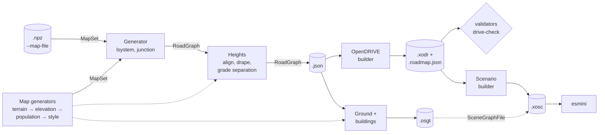

# Architecture

roadgen generates road networks as training and test environments for
autonomous driving. A network starts as a generator's abstract graph and ends
as an esmini-ready OpenDRIVE file, a traffic scenario and, optionally, a 3D
scene.

## Pipeline



| Stage | Input → output | Code | Docs |
|-------|----------------|------|------|
| Maps | params + grid + seed → `MapLayer` (`.npz` + `.png`) | `roadgen/maps/` | [Input maps](maps.md) |
| Generate | params + seed (+ `MapSet`) → `RoadGraph` | `roadgen/generators/` | [lsystem](lsystem.md), [Generators](generators.md) |
| Align | `RoadGraph` + maps → bend radius caps | `roadgen/maps/align.py` | [Heights](heights.md#1-align-bends-that-leave-legal-ground) |
| Drape | `RoadGraph` + elevation (+ terrain) → heights, bridges, tunnels | `roadgen/maps/drape.py` | [Heights](heights.md#2-drape-heights-from-the-elevation-map) |
| Separate | `RoadGraph` → overpasses where roads cross without a junction | `roadgen/geometry/grade_separation.py` | [Heights](heights.md#3-grade-separation-overpasses) |
| Build | `RoadGraph` → `.xodr` + `.roadmap.json` | `roadgen/opendrive/` (shape from `roadgen/geometry/`) | [OpenDRIVE builder](opendrive.md), [Road geometry](geometry.md) |
| Validate | `RoadGraph` / `.xodr` → errors | `roadgen/validate/` | [Validation](validation.md) |
| Drive-check | `.xodr` + sidecar → pass/fail per movement and lane | `roadgen/sim/drive_check.py` | [Validation](validation.md#drive-check) |
| Scenario | `.xodr` + sidecar → `.xosc` | `roadgen/scenario/` | [Scenarios](scenarios-and-simulation.md) |
| Simulate | `.xosc` → `SimResult` (timing, memory, errors) | `roadgen/sim/runner.py` | [Scenarios](scenarios-and-simulation.md#running-esmini) |
| Scene | `RoadGraph` + maps → ground and buildings `.osgt` | `roadgen/scene/` | [3D scene](scene.md) |

`python -m cli pipeline` runs the stages in this order. Every stage also has
its own command ([CLI reference](cli-reference.md)).

### How maps enter

Maps are inputs to a generator, never to the builder:

1. A generator that reads maps (`uses_maps = True`; only `lsystem` so far)
   reports its area with `map_bounds(params)`.
2. The CLI builds the requested maps on a grid covering that area plus
   `maps.grid.margin`, or loads them with `--map-file`.
3. The maps are built in a fixed order, terrain → elevation → population →
   style. Each one sees the earlier ones, so the stack agrees with itself.
4. The generator gets them as one `MapSet` (any layer may be missing).

A generator without `uses_maps` gets no maps. Maps requested for it are built
afterwards around the finished network, for reference only. Without maps,
`lsystem` produces exactly the same graph as before maps existed.

### How heights travel

The builder knows nothing about maps. Heights reach it through the RoadGraph:
the drape writes `Node.z`, `Edge.profile`, `Edge.bridges` and `Edge.tunnels`.
The builder fits them into `<elevationProfile>`, `<superelevation>`,
`<bridge>` and `<tunnel>`. A graph without heights gives a flat `.xodr`.
Details are in [Heights](heights.md).

## Design rules

1. **The RoadGraph is the only interface between generation and OpenDRIVE.**
   Generators never import OpenDRIVE code. The builder doesn't know which
   generator made the graph. A new generator therefore gets `.xodr` output,
   validation and scenarios for free. Road *shape* lives in the neutral
   `roadgen/geometry/` package, which both sides may use.
2. **Map kinds form a linear pipeline and are pluggable.** A map generator
   reads only earlier kinds, never a RoadGraph, and gives its standalone
   result without them. Each kind has its own registry. An `image`
   generator or `--map-file` can replace any procedural one.
3. **Every stage runs from the CLI and can be tested on its own.** Stages
   exchange files (`.json`, `.npz`, `.xodr`, `.roadmap.json`, `.xosc`).
4. **Output is deterministic.** The same parameters and seed give
   byte-identical files.
   - Randomness comes only from `numpy.random.default_rng(seed)`, with draws in
     a fixed order. Optional features draw from their own sub-streams, so
     turning one on leaves the rest of a network unchanged.
   - Map generators salt the seed with their kind and name.
   - XML timestamps are fixed to 1970-01-01.
5. **Pluggable components share one pattern:**
   - an ABC plus a `register` decorator;
   - a frozen params dataclass with presets, whose defaults come from
     `roadgen/defaults.yaml`;
   - a CLI subcommand ([Development](development.md#adding-a-component)).
6. **External tools stay external.** esmini is found through `ESMINI_HOME`
   (fallback `./esmini`) in `roadgen/sim/esmini.py`, never by a hard-coded
   path. `scenariogeneration` is only used inside the builders, so it can be
   replaced. Its geometry auto-adjustment and slow pretty-printer are
   bypassed, and XML is indented with `ET.indent`.
7. **Conventions:**
   - OpenDRIVE 1.6, right-hand traffic;
   - SI units (m, rad, m/s);
   - lane ids negative on the right of the reference line and positive on the left;
   - roads stop at the junction boundary, and connecting roads cover the junction interior.

## Module map

```
cli.py                     command-line entry point: one cmd_* per command
roadgen/
  defaults.yaml            every default parameter
  config.py                loads defaults.yaml, merges --config, builds params dataclasses
  history.py               run folders out/<hash>/, replay, run.yaml
  graph/
    model.py               Node, Edge, RoadGraph
    io.py                  JSON read/write (schema_version 1)
    plot.py                top-down plot (matplotlib, no display needed)
  maps/
    model.py               GridSpec, MapLayer (sampling, .npz I/O), MapSet
    base.py                MapGenerator ABC, per-kind registry, make_map
    noise.py               Perlin, fBm, ridged multifractal, domain warp
    terrain.py             water / land / vegetation (noise, image)
    elevation.py           heightmaps (fBm + thermal erosion, image)
    population.py          density (polycentric Clark model, image)
    style.py               street pattern per district (zones, image)
    image.py               PNG / JPEG / .npy rasters onto a grid
    plot.py                map previews, optionally with roads
    align.py               radius caps for bends whose curve leaves legal ground
    drape.py               heights, bridges and tunnels for a RoadGraph
  generators/
    base.py                RoadNetworkGenerator ABC, registry, params loading
    lsystem.py             city growth after Parish & Müller (grid and field goals, maps)
    patterns.py            street pattern fields: grid, radial, organic, contour, suburb
    junction.py            one junction or interchange per seed
    repair.py              fixes edges too short for their junctions
    transforms/            graph → graph passes: drop, culdesac, stagger, roundabout, interchange
  geometry/                neutral road shape (no OpenDRIVE imports)
    planar.py              poses, straight segments, Hermite paramPoly3
    junction_space.py      junction trims: where roads stop at a node
    design.py              design-speed rules: radii, advisory speeds, spirals, tapers
    primitives.py          line / arc / spiral pieces, alignments
    clothoid.py            G2 clothoid transitions
    chains.py              runs of edges through bends: one road each
    alignment.py           fitted reference lines (single source of road shape)
    profiles.py            lane widths and tapers, speeds, heights, bridges along a road
    vertical.py            elevation fits, junction planes, banking
    grade_separation.py    overpasses where roads cross without a junction
  opendrive/
    builder.py             OpenDriveBuilder: roads, junction wiring, sidecar
    junctions.py           movement planning and connecting roads
    lanes.py               lane sections and road marks
  validate/
    connectivity.py        traffic traps and reachability (RoadGraph)
    topology.py            ids and links (.xodr)
    continuity.py          lane position, heading, height, grade, curvature continuity (.xodr)
    dynamics.py            lateral acceleration at the posted speed (.xodr)
    clearance.py           vertical clearance where roads cross (.xodr)
    schema.py              XSD validation (optional)
  metrics/
    geometry.py            curvature and lateral-acceleration statistics of an .xodr
    network.py             layout and junction variety of a RoadGraph
    sweep.py               build-failure sweep over seeds
  scenario/
    xosc_builder.py        vehicle spawning, routes, .xosc writing
  sim/
    esmini.py              locating esmini binaries and libraries
    runner.py              running esmini with timeout, memory and load-time monitoring
    drive_check.py         driving every movement and lane with esmini's RoadManager
  scene/
    ground.py              ground mesh from the maps, levelled under the roads
    buildings.py           extruded building blocks
    osgt.py                OpenSceneGraph ASCII writer
tests/                     pytest suite; fixtures/ and data/ hold RoadGraph JSONs
runs/                      example runs (examples.sh, generated README) and inputs
plans/                     plans, discussions and reviews, with the prompts behind them
```

## Output files

All generated files go under `out/` (git-ignored), one folder `out/<hash>/`
per successful command
([run folders](cli-reference.md#run-folders-history-replay-run)). With
`-o net`:

| File | Written by | Contents |
|------|------------|----------|
| `net.json` | `generate`, `pipeline` | RoadGraph ([format](road-graph.md#json-format)) |
| `net.png` | `pipeline`, `plot-graph` | Top-down plot: highways orange, avenues red, streets blue, one-way arrows |
| `net.xodr` | `build-xodr`, `pipeline` | OpenDRIVE 1.6 road network |
| `net.roadmap.json` | same | Edge → road and node → junction ids, every junction movement ([sidecar](opendrive.md#the-roadmapjson-sidecar)) |
| `net_<kind>.npz`, `.png` | `pipeline --maps`, `map` | Input map and its preview with the roads ([maps](maps.md)) |
| `net_buildings.osgt` | `pipeline --buildings` | Buildings for esmini ([scene](scene.md)) |
| `net_scene.osgt` | `pipeline --ground`, `ground` | Ground mesh plus buildings |
| `net.xosc` | `scenario`, `pipeline --simulate` | OpenSCENARIO traffic scenario |
| `net.log`, `.stdout`, `.dat`, `.csv` | `simulate` | esmini log, console output, replayable recording, per-step CSV |
| `run.yaml` | every recorded command | The command and every parameter that differs from the defaults |
