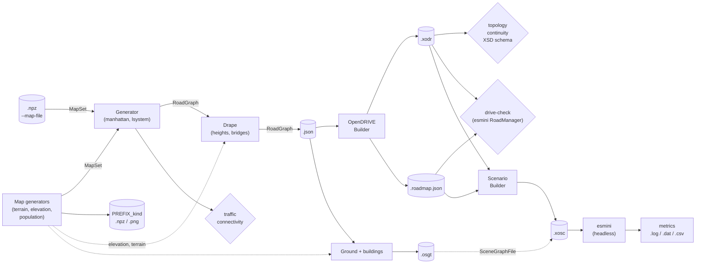
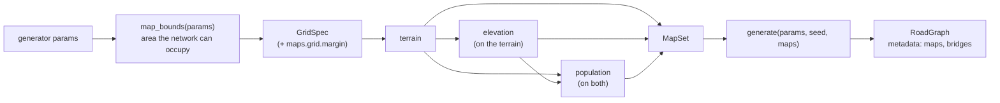

# Architecture

## Goal

The project studies large-scale traffic simulation on road networks that are
**generated procedurally**. OpenStreetMap is not used. Networks are written as
ASAM OpenDRIVE (`.xodr`), populated with traffic through OpenSCENARIO
(`.xosc`), and simulated headless in [esmini](https://github.com/esmini/esmini).
The networks scale up to grids with thousands of junctions, which supports the
scalability experiments.

## Pipeline



| Stage | Input → output | Module |
|-------|----------------|--------|
| Maps | params + grid + seed → `MapLayer` (`.npz` + `.png`) | `roadgen/maps/` |
| Generate | params + seed (+ `MapSet`) → `RoadGraph` | `roadgen/generators/` |
| Drape | `RoadGraph` + elevation (+ terrain) map → `RoadGraph` with heights and bridges | `roadgen/maps/drape.py` |
| Check traffic | `RoadGraph` → traps / unreachable roads | `roadgen/validate/connectivity.py` |
| Build | `RoadGraph` → `.xodr` + `.roadmap.json` | `roadgen/opendrive/` |
| Validate | `.xodr` → errors | `roadgen/validate/{topology,continuity,schema}.py` |
| Drive-check | `.xodr` + sidecar → per-movement pass/fail | `roadgen/sim/drive_check.py` |
| Scenario | `.xodr` + sidecar → `.xosc` | `roadgen/scenario/xosc_builder.py` |
| Simulate | `.xosc` → `SimResult` (timing, memory, errors) | `roadgen/sim/runner.py` |
| Buildings | `RoadGraph` (+ maps) → `.osgt` / `.obj` | `roadgen/scene/buildings.py` |
| Ground | maps (+ draped `RoadGraph`) → `.osgt` | `roadgen/scene/ground.py` |
| Benchmark | YAML config → `results.csv` + plots | `roadgen/bench/` |

### Input maps and the order of stages

Following Parish & Müller (2001), road growth can be driven by three raster
maps: terrain (water / land / vegetation), elevation and population density
([Input maps](maps.md)). They enter the pipeline **before** generation:



- A generator opts in with `uses_maps = True` and reports its area with
  `map_bounds(params)`. The CLI then builds the requested maps on a grid
  covering that area plus a margin, or loads them with `--map-file`, and
  passes them as one `MapSet`. Only `lsystem` does this so far.
- A generator without `uses_maps` is called exactly as before, without
  maps. Maps requested for it are built afterwards around the finished
  network, for reference only.
- The maps are built as a linear pipeline, terrain → elevation →
  population. Each map kind's generator gets the earlier maps (`upstream`),
  so the stack agrees with itself: water lies flat in the valleys, and nobody
  lives on water or steep slopes. A map loaded with `--map-file` is used as
  it is, but still feeds the kinds after it. Any of them may be missing, and
  the generator uses only what it gets. With no maps, `lsystem` produces
  exactly the same graph as without this feature.
- How `lsystem` uses each map:

  | Map | Global goals | Local constraints |
  |-----|--------------|-------------------|
  | population | Highways steer towards density peaks (inverse-distance weighted rays) | Highways stop below `highway_min_density`, streets below `street_min_density` |
  | terrain | – | Streets are pruned at water and vegetation. Highways bridge water up to `max_bridge_length` |
  | elevation | – | No road steeper than `max_grade`. Highways detour along contours |

  Details are in [Generators](generators.md#input-maps).

## Design rules

These rules come from `.github/copilot-instructions.md` (rule 2 was added with
the input maps), and the code follows them throughout:

1. **The RoadGraph is the only interface between generation and OpenDRIVE.**
   Generators never touch OpenDRIVE. The builder doesn't know which generator
   made the graph. A new generator therefore gets `.xodr` output, validation,
   scenarios and benchmarking without extra work.
   Input maps flow the other way. They are inputs to a generator (a
   `MapSet` of in-memory layers), never read by the builder. Bridges and map
   files are recorded in `RoadGraph.metadata`.
2. **Map kinds form a linear pipeline and are pluggable.** A map generator
   reads only the maps of earlier kinds (terrain → elevation → population),
   never a RoadGraph, and gives its standalone result without them. Each
   kind has its own registry, and an `image` generator or `--map-file` can
   replace any procedural one.
3. **Every stage runs from the CLI and can be tested on its own.** Each stage
   reads and writes files (`.json`, `.xodr`, `.roadmap.json`, `.xosc`), so
   you can rerun any stage alone.
4. **Output is deterministic.** The same parameters and seed give
   byte-identical files. Randomness only comes from `numpy.random.default_rng(seed)`,
   and the random draws are made in a fixed order. Timestamps that
   scenariogeneration would normally stamp are fixed to 1970-01-01. Map
   generators salt the seed with their kind and name, so one `--seed`
   gives unrelated terrain, elevation and population maps.
5. **esmini is external.** Its location comes from `ESMINI_HOME`, falling back
   to `./esmini`, and is never hard-coded (`roadgen/sim/esmini.py`).
6. **`scenariogeneration` is wrapped.** It's only used inside the builders, so
   it could be replaced later. Its geometry auto-adjustment and its slow
   minidom pretty-printer are bypassed. XML is written with `ET.indent`.
7. **Conventions:** OpenDRIVE 1.6, right-hand traffic, SI units (m, rad, m/s),
   lane ids negative on the right and positive on the left.

## Repository layout

```
cli.py                     command-line entry point (python -m cli ...)
pyproject.toml             package metadata and dependencies
configs/                   benchmark sweep configs (YAML)
roadgen/
  graph/
    model.py               Node, Edge, RoadGraph dataclasses
    io.py                  JSON (de)serialization, schema_version 1
    plot.py                matplotlib top-down rendering
  generators/
    base.py                RoadNetworkGenerator ABC, registry, params/presets loading
    manhattan.py           parametric grid (one-way patterns, ring road, jitter, drops)
    lsystem.py             Parish & Müller style growth (highways, map constraints)
  maps/
    model.py               GridSpec, MapLayer (sampling, .npz I/O), MapSet, terrain classes
    base.py                MapGenerator ABC, per-kind registry, make_map
    noise.py               Perlin, fBm, ridged multifractal, domain warp
    terrain.py             water / land / vegetation (noise, image)
    elevation.py           heightmaps (fbm + thermal erosion, image)
    population.py          density (polycentric Clark model, image)
    drape.py               heights and bridges for a RoadGraph from the maps
    image.py               reading PNG / JPEG / .npy rasters onto a grid
    plot.py                map previews with optional roads on top
  opendrive/
    builder.py             OpenDriveBuilder: roads, junction wiring, sidecar
    junctions.py           movement planning, connecting roads, junction trims
    lanes.py               lane sections and road marks
    geometry.py            poses, trimming, Hermite paramPoly3 curves
    elevation.py           <elevationProfile> fit (monotone cubic Hermite)
  validate/
    connectivity.py        traffic traps / reachability on the RoadGraph
    topology.py            ids and links in the .xodr
    continuity.py          lane-center position/heading/height/grade continuity in the .xodr
    schema.py              XSD validation (optional)
  scenario/
    xosc_builder.py        vehicle spawning, routes, .xosc writing
  sim/
    esmini.py              locating esmini binaries and libraries
    runner.py              running esmini with timeout/memory monitoring
    drive_check.py         driving every junction movement via esminiRMLib
  scene/
    buildings.py           extruded building blocks (.osgt / .obj)
    ground.py              ground mesh from the maps, levelled under roads
    osgt.py                OpenSceneGraph ASCII writer (one file, several meshes)
  bench/
    benchmark.py           resumable scalability sweep
    plots.py               report figures
tests/                     pytest suite, fixtures/ and data/ RoadGraph JSONs
docs/                      this documentation
Dockerfile, compose.yaml   containerized dev environment (see docker.md)
```

## Files produced

All generated files go under `out/`, which git ignores. For an output prefix
`out/net`:

| File | Written by | Contents |
|------|-----------|----------|
| `out/net.json` | `generate`, `pipeline` | RoadGraph ([format](road-graph.md#json-format)) |
| `out/net.png` | `pipeline`, `plot-graph` | Top-down plot: highways orange, avenues red, streets blue, one-way arrows |
| `out/net.xodr` | `build-xodr`, `pipeline` | OpenDRIVE 1.6 road network |
| `out/net.roadmap.json` | same | Edge→road and node→junction ids, every junction movement ([details](opendrive.md#the-roadmapjson-sidecar)) |
| `out/net_buildings.osgt` | `pipeline --buildings` | Building blocks for esmini |
| `out/net_scene.osgt` | `pipeline --ground`, `ground` | Ground mesh (and buildings) for esmini |
| `out/net_<kind>.npz` / `.png` | `pipeline --maps` (or `--terrain` …, `--map-file`), `map` | Input map the network was grown on, preview with roads ([details](maps.md)) |
| `out/net.xosc` | `scenario`, `pipeline --simulate` | OpenSCENARIO traffic scenario |
| `out/net.log` / `.stdout` | `simulate` | esmini log and console output |
| `out/net.dat` / `.csv` | `simulate` | esmini recording (replayable) and per-step CSV |
| `out/bench/…` | `bench` | Cached networks, scenarios, `results.csv`, `plots/` |
