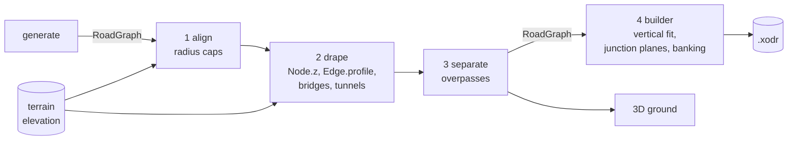

# Heights

With an elevation map, roads follow the terrain. OpenDRIVE stores a road's
height as an `<elevationProfile>` of cubic polynomials along the reference
line, z(ds) = a + b·ds + c·ds² + d·ds³, and its roll as a
`<superelevation>`. esmini's vehicles follow both.

The builder knows nothing about maps, so heights travel through the
RoadGraph:



`generate` and `pipeline` run steps 1–3 automatically
([which ones](cli-reference.md#generate)). The `align`, `drape` and
`separate` commands run them on an existing graph. `--flat` skips the drape.
A graph without heights gives a flat `.xodr`, byte-identical to one built
before heights existed.

## 1. Align: bends that leave legal ground

`roadgen/maps/align.py`, parameters under `align:`. Runs whenever there are
maps.

Roads are built along [fitted curves](geometry.md#fitted-roads) that cut
inside every bend, but the generator only checked its straight segments.
Align checks each bend's curve against the maps:

- it may not cross water where the straight corner did not;
- its terrain grade over `grade_length` (25 m) may not exceed `max_grade`
  (0.15) where the straight corner stayed within it.

A failing bend gets the largest passing radius as `Node.radius_cap`. The
builder, drape and scene all honour it.

## 2. Drape: heights from the elevation map

`roadgen/maps/drape.py`, parameters under `drape:`.

| Parameter | Default | Meaning |
|-----------|---------|---------|
| `sample_spacing` | 20 | Distance between profile points [m] |
| `smoothing` | 80 | Terrain averaging length [m]; 0 follows every bump |
| `bridge_clearance` | 2 | Lowest deck height above water [m] |
| `tunnel_cover` | 5 | A road this far under the terrain is in a tunnel [m] |

**Nodes.** Every node gets the elevation averaged over a disc `smoothing`
wide, taken at the node or, for a bend, at the fitted corner's midpoint. At
a junction, this is the height of the whole junction area.

**Edges.** Every edge gets heights every `sample_spacing` along it, sampled
under the fitted road. The height is the elevation averaged along the road
over `smoothing`, since a road is graded and not draped over every bump. It
is then shifted linearly to meet its nodes' heights exactly.

The drape does not enforce a grade limit; it logs the steepest grade.
lsystem keeps its own roads under `max_grade` while growing.

### Bridges

Stretches of an edge's fitted road over water become `Edge.bridges`. The
terrain map is sampled at its own resolution to find them.

- **Deck.** On a bridge, the deck runs straight from shore to shore and stays
  at least `bridge_clearance` above the water. A node on water is raised the
  same way.
- **Why it's needed.** Without this, a bridge would dip to the water, which
  lies flat at `min_elevation` ([elevation map](maps.md#elevation-fbm-fractal-terrain)).

### Tunnels

Highway edges listed in `metadata["tunnels"]` (from
[lsystem](lsystem.md#freeways-tunnels-and-interchanges)) run at a constant
grade instead of following the terrain. Their stretches at least
`tunnel_cover` below the terrain become `Edge.tunnels`.

## 3. Grade separation: overpasses

`roadgen/geometry/grade_separation.py`, parameters under
`grade_separation:`. A RoadGraph is planar, except where a generator lets two
roads cross without a shared node (lsystem's freeways). Every such crossing
becomes an overpass:

- **Which road goes over.** The higher class goes over (highway > avenue >
  street), or the lower edge id on a tie. Crossings are found between
  straight edges, but placed where the *fitted* roads cross, since a curve
  can move a crossing tens of metres.
- **How high.** `clearance` (6 m: 5 m clearance plus a 1 m deck) above the
  lower road, from the heights already in the graph.
- **The bump.** A flat top over the lower road (its half width / sin of the
  crossing angle, plus `flat_margin`, 5 m). Then smoothstep ramps no steeper
  than `max_grade` (5 %), along the upper road through its straightest
  continuation at each node. The flat top is a bridge span, so the ground
  isn't levelled under it.
- **Side roads.** Roads joining the raised stretch ramp down from the height
  where they meet it, at the same grade, so no junction gets a step.
  - The lower road is never raised.
  - A node that ends a lower road and lies on a raised stretch stays down
    (logged), which can leave a step there.

The crossings are listed in `metadata["overpasses"]`, and the
[clearance validator](validation.md#clearance) checks the result.

## 4. In the builder: vertical fit, junction planes, banking

`roadgen/geometry/vertical.py`. The builder writes heights only if
`RoadGraph.has_elevation`.

- **Junction planes** (`junction_planes`). Every junction area is a plane
  `z = z0 + gx·(x − x0) + gy·(y − y0)` through its node's height. It is
  least-squares fitted to the approach roads' heights 10 m in, and its
  gradient is capped at `design.junction_max_grade` (4 %; 0 makes junctions
  flat).
- **Road profiles** (`chain_elevation`). A monotone cubic Hermite spline
  (PCHIP) through all height samples of a chain, placed by station. Height and
  slope are continuous, and it never overshoots the samples. Bend nodes are
  ordinary knots.
  - A road ends on its junction's plane, with the plane's grade along it.
    Dead ends are flat at the end.
  - Each road's fit becomes its `<elevationProfile>`.
- **Banking** (`chain_superelevation`, `design.banking`, on by default).
  - **Corners.** Every corner rolls towards its centre by `atan(e)` on its
    arc. `e` comes from the [design rules](geometry.md#design-speed-rules)
    using the innermost lane radius, so a design-radius corner gets exactly
    `e_max`.
  - **Runoff.** A smoothstep runoff along the corner's spirals keeps the roll
    rate 0 where curves start and end.
  - **Junction approach.** Over `bank_ramp_length` (30 m) before a sloped
    junction, the road rolls to the plane's cross slope. Overlapping parts
    add up.
  - Design radii count on this banking. It is written as
    `<lateralProfile><superelevation>`.
- **Connecting roads** (`path_profiles`) lie on their junction's plane.
  Their elevation and superelevation are cubic Hermite pieces that match the
  plane's height, grade, roll and roll rate exactly at both ends. Every road
  of a junction therefore meets at the same height, grade and roll.
- **Lane centres.** esmini evaluates a lane centre as roadgen does: `t`
  across the road surface, pitched by the grade and rolled about its pitched
  tangent.
- **Bridges and tunnels** become `<objects><bridge type="concrete">` and
  `<tunnel>` records. Spans that touch across a bend node are merged.

**Validation.** The [continuity check](validation.md#continuity) compares
height (1 cm) and grade (0.01) at every contact point. Drive-check confirms
that esmini reads the same heights.

```bash
python -m cli pipeline lsystem --preset city --maps --allow-traps --ground --buildings -o hills
python -m cli pipeline lsystem --preset city --maps --allow-traps --flat     # roads stay flat
python -m cli drape out/<hash>/net.json --map-file elevation=out/<hash>/net_elevation.npz \
    --map-file terrain=out/<hash>/net_terrain.npz                           # -> net.draped.json
```
