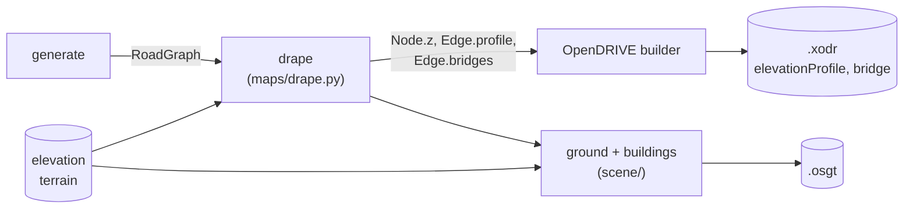

# Input maps

Parish & Müller (2001) drive their road growth with 2D image maps: a
land/water/vegetation map, an elevation map and a population density map
(Section 1.2, Figure 2). Highways look for population peaks, and local
constraints keep roads out of water and off steep slopes. The paper's maps
were not downloaded. They were "generated either by drawing them or by
scanning from statistical and geographical maps" (Section 2, citing the
printed *Four World Cities Transport Study*), and the Figure 2 city is
imaginary.

`roadgen/maps/` generates these three maps procedurally and can also read
real ones from images. The `lsystem` generator grows on them: highways head
for population peaks and bridge rivers, and streets stop at shores, parks,
steep slopes and empty land. See
[Generators → Input maps](generators.md#input-maps) for the rules and
[Architecture](architecture.md#input-maps-and-the-order-of-stages) for how
the maps enter the pipeline.

## Design

- **A linear pipeline: terrain → elevation → population.** Each kind has
  its own registry, and the kinds are built in this order. A generator gets
  the maps of the earlier kinds as `upstream` (a `MapSet`, any layer may be
  missing): elevation reads the terrain, population reads both. So the
  stack is consistent: water lies flat in the valleys, and nobody lives on
  water, in parks or on steep slopes. A generator never reads a later kind
  or a RoadGraph. Without upstream maps it gives exactly its standalone
  result, so any terrain generator still works with any elevation and
  population generator. The kinds use unrelated random streams for the
  same seed (the seed is salted with the kind and generator name).
- **Same pattern as the road generators.** Each generator is a
  `MapGenerator` subclass with a frozen params dataclass whose defaults come
  from `roadgen/defaults.yaml` (`maps:`). It is registered with
  `@register_map(kind, name)`, may offer presets, and is deterministic for
  (params, grid, seed). Parameters use the same layering: `defaults.yaml` <
  `--config` < `--preset` < `--params` < `--set`.
- **One grid, world coordinates.** A `GridSpec` (lower-left `origin`,
  `size` in metres, square `cell_size`) defines where a map lies. Noise is
  sampled in world metres divided by a feature `scale`, so changing only
  `cell_size` changes the resolution, not the landscape.
- **Files.** A `MapLayer` is stored as `.npz` (the array plus JSON metadata:
  kind, grid, generator, seed, params) with a `.png` preview next to it.
  Row 0 of the array is the **south** edge (`imshow(origin="lower")`).
  `MapLayer.sample(x, y)` reads values at world points (nearest cell for
  terrain, bilinear otherwise). A road generator receives the layers as
  one `MapSet(terrain=…, elevation=…, population=…)`; each may be `None`.

| Kind | Values | dtype | Generators |
|------|--------|-------|-----------|
| `terrain` | `0` water, `1` land, `2` vegetation (park / forest) | `uint8` | `noise`, `image` |
| `elevation` | height [m] | `float32` | `fbm`, `image` |
| `population` | density [people/km²] | `float32` | `centers`, `image` |

## `terrain noise`: lakes, coast, rivers, vegetation (`terrain.py`)

Three features, each drawn from its own random stream. Adding a river
therefore leaves the lakes and parks unchanged.

1. **Lakes / sea.** Domain-warped fBm (Perlin octaves) is thresholded at its
   `water_fraction` quantile, so the share of water is exact before
   smoothing. `coast_strength` blends in a linear ramp, which pushes the
   water to one side (`coast_angle_deg`, or random) and turns lakes into a
   sea. `smoothing` runs 3×3 majority passes that remove speckles.
2. **Rivers.** Each river is a band `river_width` wide through a random point
   in the middle half of the map, in a random direction. Its centre line is a
   sine meander (`river_meander` amplitude, `river_wavelength`) made
   irregular by 1D fBm.
3. **Vegetation.** The top `vegetation_fraction` of the land in another fBm
   field (`vegetation_scale`) becomes park / forest.

Presets: `inland` (no water), `lakes`, `coastal`, `river_city`.

## `elevation fbm`: fractal terrain (`elevation.py`)

This follows Musgrave et al. (1989), which Parish & Müller cite for terrain.

1. Domain-warped fBm. `ridge` blends in a ridged multifractal (sharp
   crests, as in mountain ranges).
2. The result is stretched to [0, 1] and raised to `exponent`. Values above
   1 flatten valleys and sharpen peaks.
3. It is scaled to [`min_elevation`, `max_elevation`].
4. Thermal erosion runs for `erosion_iterations` passes. Where the step to a
   4-neighbour exceeds `tan(talus_deg) · cell_size`, `erosion_rate` of the
   excess slides downhill. Total height is conserved. This rounds off the
   unnaturally steep slopes that raw noise has.

**On a terrain map** (the pipeline, or `map elevation fbm --on terrain=…`)
with any water, step 3 changes: land rises from `shore_height` above the
water at the shore to its full noise height `shore_width` away (smoothstep
over the distance to the nearest water cell). After erosion every water
cell is set flat to `min_elevation`, the water surface, and land is kept at
least `shore_height` above it. Lakes, rivers and the sea therefore lie in
valleys, all at the same level. A terrain without water changes nothing.
Too small a `shore_width` packs the whole relief into steep banks that
roads cannot climb (`max_grade`). The default of 600 m keeps the share of
steep cells about the same as without terrain.

Presets: `flat`, `rolling`, `hilly`, `mountainous`.

## `population centers`: polycentric density (`population.py`)

This is a polycentric form of Clark's (1951) urban density model,
D(r) = D₀·e^(−r/b). Density falls exponentially with distance from a
centre.

1. `n_centers` centres are placed at random, at least `min_center_distance`
   apart and `center_margin` away from the edges. The first is the main
   centre, with weight 1. The others get a weight drawn from
   `secondary_weight`, and their decay length is scaled by √weight.
2. Density is the sum of the centre profiles: `exponential` (Clark) or
   `gaussian` (flatter core), with `peak_density` at the main centre.
3. The sum is multiplied by `1 + noise_amount · fBm` (`noise_scale`) for
   neighbourhood-scale variation, and `base_density` is added everywhere.

**On terrain / elevation maps** each cell's density is multiplied by its
habitability, a factor in [0, 1]. It is 0 on water and `vegetation_factor`
in parks / forest, and it falls linearly from 1 on flat ground to 0 at
`max_slope_deg` (0 turns the slope limit off). Centres are only placed where
the factor is at least 0.5, so a city never centres on a lake or a cliff.

The centres are stored in the layer's metadata (`centers: [[x, y, weight], …]`),
for reference. A layer built on upstream maps lists them in
`metadata.upstream`. Presets: `monocentric`,
`polycentric`, `sprawl`.

## `image`: real or hand-drawn maps

Every kind has an `image` generator that stretches a PNG / JPEG (or `.npy`)
over the grid. The first row of the image is the **north** edge. `path` is
required. Image maps are used as given; they don't adapt to upstream maps
(real data is consistent already), but they do feed the kinds after them.

| Kind | How pixels become values |
|------|--------------------------|
| `terrain` | Color image: nearest of `water_color` / `land_color` / `vegetation_color`. Grayscale image (also gray saved as RGB): a water mask, water where darker than `gray_threshold` (`water_is_dark: false` flips this) |
| `elevation` | Grayscale 0..1 → `min_elevation`..`max_elevation`. `stretch: true` maps the raster's own min..max instead (use this for 16-bit or `.npy` data in arbitrary units) |
| `population` | Grayscale 0..1 → `min_density`..`max_density` |

GeoTIFFs are not read directly (that would add a GDAL/rasterio dependency).
Convert them first:

```bash
gdal_translate -of PNG -ot UInt16 -scale srtm_tile.tif heightmap.png
```

## Where to get real maps

All of these are free. Crop them to your area and export a grayscale or
class-colored PNG.

| Kind | Source | Notes |
|------|--------|-------|
| Elevation | [Tangram Heightmapper](https://tangrams.github.io/heightmapper/) | Draws a grayscale heightmap of any view in the browser and exports a PNG directly. The quickest option |
| Elevation | [Copernicus DEM GLO-30](https://registry.opendata.aws/copernicus-dem/) | 30 m global DEM (GeoTIFF) |
| Elevation | [SRTM via USGS EarthExplorer](https://earthexplorer.usgs.gov/), [OpenTopography](https://opentopography.org/) | 30 m (1 arc-second) global DEM |
| Terrain (water) | [JRC Global Surface Water](https://global-surface-water.appspot.com/) | 30 m water occurrence, a ready-made water mask |
| Terrain (water / vegetation) | [ESA WorldCover](https://esa-worldcover.org/) | 10 m land cover: water, tree cover, grassland, built-up, … Recolor the classes to the three terrain colors |
| Terrain (Europe) | [CORINE Land Cover](https://land.copernicus.eu/) | 100 m land cover, 44 classes |
| Population | [GHSL GHS-POP](https://human-settlement.emergency.copernicus.eu/) | JRC global population grid, 100 m / 1 km, several epochs |
| Population | [WorldPop](https://www.worldpop.org/) | 100 m population counts per country |
| Population | [HDX: Meta High Resolution Population Density](https://data.humdata.org/) | ~30 m, many countries |
| Population | [NASA SEDAC GPWv4](https://sedac.ciesin.columbia.edu/data/collection/gpw-v4) | ~1 km global density |
| All | [Virtual Terrain Project](http://vterrain.org/) | The terrain resource Parish & Müller cite ([32]) |

Population grids give people per cell. Divide by the cell area in km² (or
choose `max_density` to match) to get people/km².

## CLI

```bash
python -m cli maps                                             # generators, presets, parameters

# One map on its own grid (default origin [0, 0], size 3000 x 3000 m, 10 m cells)
python -m cli map terrain noise --preset coastal --seed 3 -o out/coast
python -m cli map elevation fbm --preset hilly --size 4000 3000 --cell-size 20
python -m cli map population centers --set n_centers=5 --graph out/net.json   # roads on the preview
# The pipeline by hand: elevation on the terrain, population on both
python -m cli map elevation fbm --on terrain=out/coast.npz -o out/coast_elev
python -m cli map population centers --on terrain=out/coast.npz \
    --on elevation=out/coast_elev.npz -o out/coast_pop
python -m cli map elevation image --set path=heightmap.png --set max_elevation=250
python -m cli plot-map out/coast.npz out/coast_roads.png --graph out/net.json

# In the pipeline: lsystem grows on the maps (grid = its area + maps.grid.margin)
python -m cli pipeline lsystem --preset city --allow-traps --maps
python -m cli pipeline lsystem --preset city --allow-traps --terrain noise --population centers \
    --map-set terrain.rivers=2 --map-set population.n_centers=1
python -m cli pipeline lsystem --preset city --allow-traps --maps --elevation image \
    --map-set elevation.path=heightmap.png

# Reuse maps from files (e.g. made with `map`, or by an earlier pipeline run)
python -m cli generate lsystem --preset city --map-file terrain=out/coast.npz \
    --map-file population=out/lsystem_city_s0_population.npz -o out/net.json

# Generators without map support get the maps around the network, for reference
python -m cli pipeline manhattan --preset manhattan_like --maps
```

`pipeline --maps` uses the generators named in `maps.pipeline` of the
config and builds terrain, then elevation on it, then population on both. `--terrain/--elevation/--population NAME` choose one kind
explicitly, and `--map-file KIND=FILE.npz` loads one (it wins over a
generator for that kind). `generate` takes `--map-file` too. A map file
should cover the generator's area; a file made for another area logs a
warning. The pipeline writes `PREFIX_<kind>.npz` and a `.png` with the roads
drawn on top, and lists the maps in the RoadGraph's `metadata.maps`. Defaults
for every map parameter can be changed with `--config`, for example:

```yaml
maps:
  grid: {cell_size: 5.0}
  terrain:
    noise: {water_fraction: 0.25, coast_strength: 0.7}
```

## Adding a map generator

```python
from dataclasses import dataclass
import numpy as np
from roadgen.maps.base import MapGenerator, register_map
from typing import Optional
from roadgen.maps.model import GridSpec, MapLayer, MapSet

@dataclass(frozen=True)
class RampParams:
    slope: float = 0.05  # m per m

@register_map("elevation", "ramp")
class RampGenerator(MapGenerator[RampParams]):
    params_type = RampParams
    description = "plane rising towards +x"

    def generate(self, params: RampParams, grid: GridSpec, seed: int,
                 upstream: Optional[MapSet] = None) -> MapLayer:
        x, _ = grid.cell_centers()
        z = (x - grid.origin[0]) * params.slope
        return MapLayer("elevation", grid, z.astype(np.float32),
                        {"generator": self.name, "seed": seed})
```

Import the module in `roadgen/maps/__init__.py`. If the parameters should be
configurable, add them under `maps.elevation.ramp` in `defaults.yaml`. The
generator then shows up in `maps`, `map elevation ramp` and `pipeline
--elevation ramp`. Use `self.rng(seed)` (or `self.seed_sequence(seed).spawn(n)`
for independent features) for all randomness. `upstream` holds the maps of
the earlier kinds (an elevation generator may read `upstream.terrain`); read
them with `layer.on_grid(grid)`, which also resamples a layer from another
grid, and give the standalone result when they are missing.

## Heights: from the maps to esmini

With an elevation map, roads are no longer flat. OpenDRIVE stores heights
per road as an `<elevationProfile>` of cubic polynomials along the
reference line, z(ds) = a + b·ds + c·ds² + d·ds³, and esmini's vehicles
follow it. The builder still knows nothing about maps; the heights travel
through the RoadGraph:



0. **Align** (`roadgen/maps/align.py`, parameters under `align:`, CLI
   `align`; the pipeline runs it whenever there are maps). Roads are built
   along fitted curves ([road geometry](geometry.md#chains-and-fitted-roads))
   that cut inside every bend, but the generator only checked its straight
   segments. Each bend's curve is checked against the maps: it may not cross
   water where the straight corner did not, and the terrain grade along it
   (over `grade_length`, 25 m) may not exceed `max_grade` (0.15) where the
   straight corner stayed within it. A bend that fails gets the largest
   radius that passes as `Node.radius_cap`, which the builder, drape and
   scene then all honour. Without maps nothing is written.
1. **Drape** (`roadgen/maps/drape.py`, parameters under `drape:`). Every node
   gets the elevation averaged over a disc `smoothing` (80 m) wide, at the
   node or, for a bend, at the fitted road's corner midpoint; at a junction
   this is the height of the junction area. Every edge gets heights every
   `sample_spacing` (20 m) along the straight edge, sampled under the fitted
   road: the elevation averaged along the road over `smoothing` (a road is
   graded, not draped over every bump), shifted linearly so it meets its
   nodes' heights exactly.
2. **Bridges.** Stretches of an edge's fitted road over water (from the
   terrain map, sampled at its own resolution) become `Edge.bridges`. On them the deck
   runs straight from shore to shore and stays at least `bridge_clearance`
   (2 m) above the water surface. A node on water is raised the same way.
   The water surface is flat at `min_elevation` (see the elevation map
   above), so without this a bridge would dip down to the water.
3. **Profiles** (`roadgen/geometry/vertical.py`). The builder fits each
   chain road's heights with a monotone cubic Hermite spline (PCHIP): height
   and slope are continuous, and it never overshoots the samples. Bend nodes
   are ordinary knots. A road ends on its junction's plane (flat at the
   node's height unless sloped junctions are on), and connecting roads lie on
   the same plane, so every road of a junction meets at the same height and
   grade.
   Bridges become `<objects><bridge type="concrete">` records.
4. **Validation.** The continuity check also compares height (1 cm) and
   grade (0.01) at every contact point. esmini's RoadManager reads the same
   heights (checked in `tests/test_elevation.py`).
5. **Scene** (`roadgen/scene/`). esmini draws only roads, so `--ground`
   adds the terrain: a mesh from the elevation map every `ground.cell_size`
   (20 m), colored by terrain class, and levelled `below_road` (0.3 m)
   under every road and junction area, along the same fitted roads, junction
   trims, junction planes and profile fit as the builder (a KD-tree finds
   the nearest point of each road), so the ground never covers a road. Under bridges
   it is left alone. Buildings stand on the ground (base 1 m below the
   lowest ground under them) and none stand on water. Ground and buildings
   share one `PREFIX_scene.osgt`, because esmini takes a single
   SceneGraphFile.

```bash
python -m cli pipeline lsystem --preset city --allow-traps --maps --ground --buildings -o out/hills
python -m cli pipeline lsystem --preset city --allow-traps --maps --flat      # roads stay flat
python -m cli drape out/net.json --map-file elevation=out/net_elevation.npz \
    --map-file terrain=out/net_terrain.npz                                    # -> out/net.draped.json
python -m cli ground out/scene.osgt --map-file elevation=out/net_elevation.npz \
    --graph out/net.draped.json --buildings
```

A graph without heights (all `Node.z = 0`, no profiles) gives exactly the
same `.xodr` and `.json` as before.

## Next steps

- **Banking and sloped junctions.** Roads have no superelevation
  (`<lateralProfile>`; scenariogeneration offers
  `Road.add_superelevation`), and every junction area is flat. On steep
  ground a junction on a sloped plane would need fewer height changes on
  its approaches.
- **Grade limits after draping.** lsystem keeps grades under `max_grade`
  while growing, but drape does not enforce one (it logs the steepest
  grade). manhattan networks on hilly maps can therefore get steep roads.
- **Street patterns from maps.** The paper blends pattern rules (New York,
  Paris, San Francisco) with a pattern control map. Streets here always use
  the grid goal.
- **Vegetation from elevation.** In the linear pipeline, terrain can't see
  elevation, so forests don't prefer steep or high ground. That would need
  a post-step on the terrain after elevation.
- **manhattan** ignores maps while growing (it only gets heights). It has no
  growth step that a constraint could act on.
